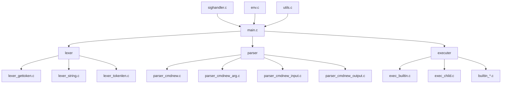
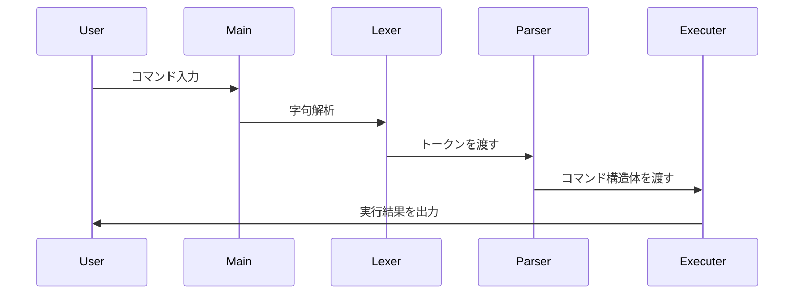

# minishell

42Tokyoのプロジェクトとして開発されたBashを模倣したシェルプログラムです。

## 作成者

**kmiyazaw**

## 概要

minishellは、bashシェルの基本的な機能を再実装したプログラムです。コマンドライン解析、環境変数管理、パイプ処理、リダイレクション、内蔵コマンドなど、シェルの主要な機能を提供します。

## 機能

### 内蔵コマンド
- `echo` - テキストの出力（-nオプション対応）
- `cd` - ディレクトリ変更
- `pwd` - 現在のディレクトリパスを表示
- `export` - 環境変数の設定
- `unset` - 環境変数の削除
- `env` - 環境変数の表示
- `exit` - プログラムの終了

### シェル機能
- コマンドの実行
- パイプ処理（`|`）
- リダイレクション（`<`, `>`, `>>`）
- Here Document（`<<`）
- 環境変数の展開（`$VAR`）
- シングルクォート（`'`）とダブルクォート（`"`）の処理
- シグナル処理（Ctrl+C, Ctrl+D, Ctrl+\\）

## プログラム構造

### アーキテクチャ



### 処理フロー



## ビルド方法

### 必要な依存関係

**macOS:**
```bash
brew install readline
```

**Linux:**
```bash
sudo apt install libreadline-dev
```

### コンパイル

```bash
make
```

### 実行

```bash
./minishell
```

### クリーンアップ

```bash
make clean    # オブジェクトファイルの削除
make fclean   # 全ての生成ファイルの削除
make re       # 再ビルド
```

## ファイル構成

```
minishell/
├── Makefile
├── README.md
├── include/
│   ├── minishell.h
│   ├── minishell_constants.h
│   └── minishell_typedef.h
├── libft/              # 自前ライブラリ
│   ├── Makefile
│   ├── libft.h
│   └── *.c
└── src/
    ├── main.c          # メイン処理
    ├── lexer*.c        # 字句解析
    ├── parser*.c       # 構文解析
    ├── executer.c      # 実行処理
    ├── exec_*.c        # 実行関連
    ├── builtin_*.c     # 内蔵コマンド
    ├── env.c           # 環境変数処理
    ├── sighandler.c    # シグナル処理
    └── utils*.c        # ユーティリティ
```

## 使用例

```bash
# 基本的なコマンド実行
minishell $ echo "Hello, World!"
Hello, World!

# 環境変数の設定と使用
minishell $ export GREETING="Hello"
minishell $ echo $GREETING
Hello

# パイプ処理
minishell $ ls | grep .c

# リダイレクション
minishell $ echo "test" > output.txt
minishell $ cat < output.txt

# Here Document
minishell $ cat << EOF
> This is a test
> EOF
This is a test
```

## 技術仕様

- **言語**: C
- **標準**: C99
- **コンパイラフラグ**: `-Wall -Wextra -Werror`
- **外部ライブラリ**: readline
- **対応OS**: macOS, Linux

## 学習ポイント

このプロジェクトを通じて以下の技術を習得できます：

- シェルの動作原理
- 字句解析・構文解析の実装
- プロセス管理とプロセス間通信
- ファイルディスクリプタとリダイレクション
- シグナル処理
- 環境変数の管理
- メモリ管理とリーク対策

## 制限事項

- 一部の高度なbash機能は実装されていません
- 履歴機能は基本的なもののみ対応
- ワイルドカード展開は未実装

---

*42Tokyo minishell project - bashシェルの基本機能を学習するための教育プログラム*